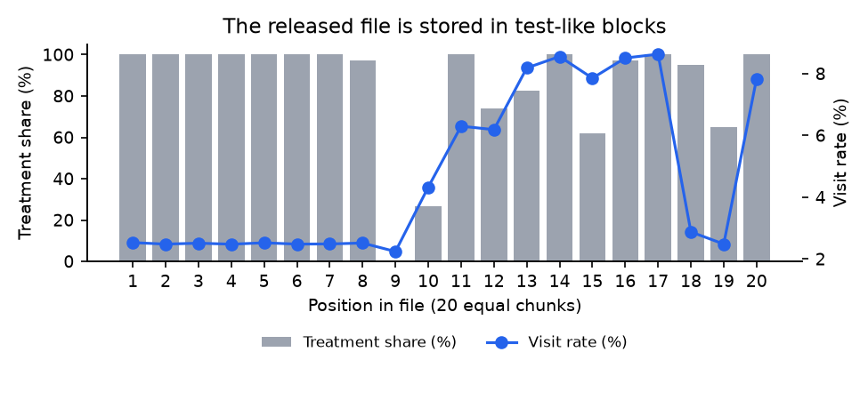
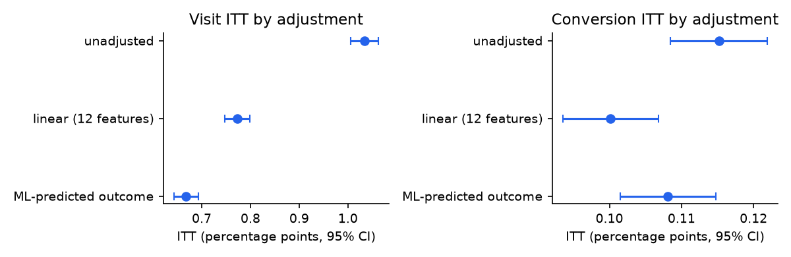
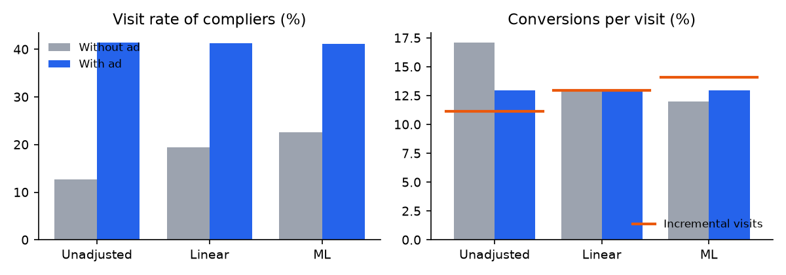
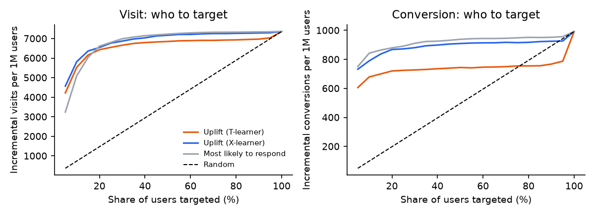
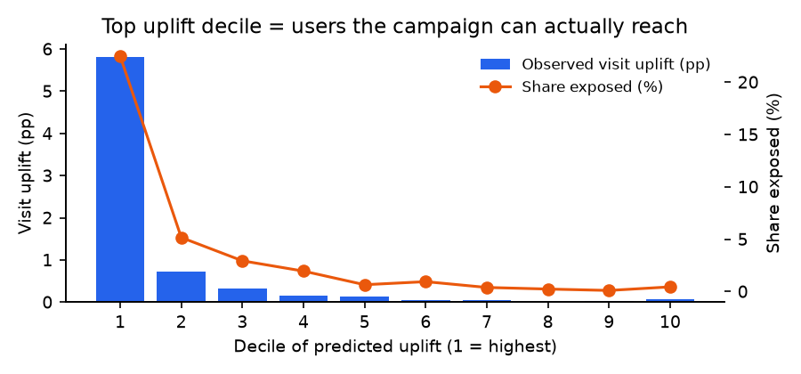

# Who Does the Ad Actually Move? Ad Incrementality on 14 Million Users

**Yuran Sun** · Ph.D. Candidate, University of Florida · M.S. Statistics

Data: [Criteo Uplift Prediction Dataset v2.1](https://huggingface.co/datasets/criteo/criteo-uplift) (13,979,592 users from randomized ad incrementality tests)

This project measures how much a display ad campaign really changes what people do: whether they visit the advertiser's site and whether they buy. It goes from auditing the experiment, to estimating the effect of the campaign and of the ad itself, to breaking the effect down along the post-ad purchase journey, to deciding whom to target.

> Status: first public version (October 2026). Analyses are complete for Steps 1–3; the write-up will keep improving.

---

## Key findings

1. **Most of the "treatment group" never saw an ad.** Only 3.6% of users assigned to see ads were actually shown one. The campaign raises the visit rate by about 0.7–0.8 percentage points, but for the people who actually saw the ad, the effect is about 19–22 percentage points.
2. **A naive A/B comparison overstates the visit effect by about one third.** The experiment passes the standard checks (sample ratio, covariate balance), yet a prognostic balance check shows the treatment group was already 0.27 pp more likely to visit before any ad was shown. The raw file is stored in test-like blocks with very different treatment shares and baselines, which points to several pooled tests (a Simpson's-paradox-type imbalance). Covariate adjustment brings the visit effect from 1.03 pp down to 0.67–0.77 pp.
3. **The ad works by bringing people in, not by changing what they do once they arrive.** Among users who see the ad, it roughly doubles the visit rate (from about 20% to 41%), while conversion per visit stays about the same (about 13% with and without the ad). Visits created by the ad convert about as well as other visits. The unadjusted funnel tells the opposite, wrong story ("ads bring low-quality traffic").
4. **The incremental effect is highly concentrated.** Targeting the top 10% of users by predicted uplift captures about 79% of all incremental visits, compared with 69% when targeting the users most likely to visit. The advantage of uplift models disappears by a 20% budget, and for conversions, simply targeting likely buyers works as well. The top uplift decile is largely the set of users the campaign can actually reach (22% exposed vs 3.6% on average).

## Why this matters for product and user research

- **Check the experiment before trusting the result.** Passing a sample-ratio check is not enough when tests are pooled; a balance check that weights features by how much they predict the outcome caught a bias that standard checks missed.
- **Report both effects.** The campaign effect (ITT) answers "is the budget worth it?"; the effect on people who saw the ad (CACE) answers "how persuasive is the ad itself?". Reporting only one misleads in either direction.
- **The post-click experience is the next lever.** About 87% of visitors leave without converting, whether or not they came from the ad. More ad spend brings more visitors who behave the same way; understanding why visitors drop off is a question behavioral data alone cannot answer (see the proposed study below).
- **"Who responds" and "who can be reached" are different questions.** Much of the apparent heterogeneity in ad effects comes from differences in exposure, which is a delivery question, not a persuasion question.

---

## Approach

| Step | Question | Methods | Code |
|---|---|---|---|
| 1. Audit | Can we trust the experiment? | Completeness and consistency checks, sample ratio mismatch (chi-square), standardized mean differences, classifier-based randomization check (AUC), compliance | `src/audit.py`, `src/step1b_row_order.py` |
| 2. Effects | How much does the campaign, and the ad itself, change behavior? | Difference in means (Welch SE); instrumental variables / Wald estimator for the complier average causal effect (CACE) with robust SEs; Lin (2013) regression adjustment; cross-fitted ML-predicted outcome as a covariate (CUPAC-style); prognostic balance check | `src/step2_itt_cace.py` |
| 2b. Funnel | Where in the purchase journey does the ad work? | Complier means with and without the ad via IV; conversion per visit and conversion per incremental visit as IV ratios with robust SEs | `src/step2b_funnel.py` |
| 3. Targeting | Whom should the campaign target? | T-learner and X-learner uplift models (gradient boosting), held-out evaluation with doubly robust (AIPW) scores, uplift curves, decile profiles, ranking stability | `src/step3_uplift.py` |

---

## Results

### Step 1: Audit

| Check | Result |
|---|---|
| Missing values; conversions without a visit; exposure in control | None |
| Sample ratio (designed 85/15) | 0.8500 observed, p = 0.999 |
| Covariate balance | All 12 features \|SMD\| ≤ 0.049 |
| Can features predict assignment? | AUC = 0.508 (about 5.6 SE above 0.5): small but systematic imbalance |
| Compliance | 3.6% of the treatment group was exposed |

The raw file order reveals test-like blocks: some stretches are 100% treatment, one is 100% control, and visit rates jump between 2% and 9%.



### Step 2: Campaign effect (ITT) and ad effect (CACE)

| Outcome | Adjustment | ITT, pp [95% CI] | CACE, pp [95% CI] |
|---|---|---|---|
| Visit | Unadjusted | 1.034 [1.006, 1.063] | 28.70 [27.91, 29.49] |
| Visit | Linear (12 features) | 0.773 [0.748, 0.799] | 21.83 [21.11, 22.55] |
| Visit | ML-predicted outcome | 0.668 [0.643, 0.693] | 18.66 [17.96, 19.36] |
| Conversion | Unadjusted | 0.115 [0.108, 0.122] | 3.20 [3.01, 3.38] |
| Conversion | Linear (12 features) | 0.100 [0.094, 0.107] | 2.83 [2.64, 3.02] |
| Conversion | ML-predicted outcome | 0.108 [0.101, 0.115] | 3.00 [2.82, 3.19] |

- Adjusted and unadjusted visit intervals do not overlap. In a clean randomized experiment adjustment should only narrow the interval, so the shift signals pre-treatment imbalance.
- Prognostic balance check (model trained on control only, cross-fitted): predicted baseline visit rate 4.09% in treatment vs 3.82% in control, a 0.27 pp gap (SE 0.008 pp).
- Adjustment narrows visit intervals by 10–13% (equivalent to 24–31% more sample) but conversion intervals by only 1–2%, because the features predict rare conversions poorly.
- When the ML adjustment uses both predicted visits and predicted conversions, the conversion CACE is 2.62 pp; the conversion effect is best reported as about 2.6–2.8 pp.



### Step 2b: Post-ad funnel (compliers)

| Quantity, % | Unadjusted | Linear | ML |
|---|---|---|---|
| Visit rate without / with the ad | 12.8 / 41.5 | 19.5 / 41.3 | 22.6 / 41.2 |
| Conversion per visit without / with the ad | 17.1 / 13.0 | 13.1 / 13.0 | 12.0 / 12.9 |
| Conversion per incremental visit | 11.1 | 13.0 | 14.1 |



### Step 3: Whom to target (held-out half, 7 million users)

| Ranking | Share of all incremental visits captured, top 10% | top 20% | Share of incremental conversions, top 10% |
|---|---|---|---|
| Most likely to respond | 69% | 90% | 85% |
| Uplift, T-learner | 75% | 87% | 68% |
| Uplift, X-learner | 79% | 89% | 80% |

- Rankings by response and by uplift agree only moderately (rank correlation 0.59).
- Ranking stability: T-learners trained on two independent halves agree on 71% of the top-10% users (rank correlation 0.44), so individual-level uplift scores are noisy even with millions of users.
- In the top X-learner decile, 22% of users were exposed (vs 3.6% overall) and the baseline visit rate is 21% (vs 3.8%).




---

## Proposed follow-up study (design only)

This dataset contains behavioral outcomes only; it has **no survey or self-reported data**. The natural next step is a study that pairs a short survey with backend data to explain the patterns above:

- **Who:** samples from the high-uplift segment, the "reachable but unresponsive" segment, and visitors who leave without converting.
- **What to ask:** ad recall, perceived relevance, purchase intent, and the main reason for not buying.
- **How to analyze:** link responses to each user's exposure, visit, and conversion records; compare stated intent with actual conversion; check whether stated reasons differ across behavioral segments.
- **Decision it informs:** whether to invest next in targeting, creative, or the post-click experience.

## Limitations

- The data were sub-sampled non-uniformly and features are anonymized, so absolute rates are not Criteo's real numbers; comparisons and methods still apply.
- Adjustment removes only the imbalance captured by the 12 features; test IDs are not released, so the pooled-tests explanation is well supported but not proven.
- Linear and ML adjustments differ, so effects are reported as ranges.
- The funnel has two stages (visit, conversion); there is no click, add-to-cart, or checkout data.
- CACE assumes that being assigned to the treatment group affects behavior only through seeing the ad.

## Reproduce

```bash
python -m venv .venv && .venv/bin/pip install -r requirements.txt
# download criteo-uplift-v2.1.csv.gz from Hugging Face into data/raw/, then:
.venv/bin/python src/convert.py           # CSV -> parquet
.venv/bin/python src/audit.py             # Step 1
.venv/bin/python src/step1b_row_order.py  # Step 1b
.venv/bin/python src/step2_itt_cace.py    # Step 2 (~1.5 min)
.venv/bin/python src/step2b_funnel.py     # Step 2b (~2 min)
.venv/bin/python src/step3_uplift.py      # Step 3 (~4 min)
.venv/bin/python src/make_figures.py
```

The data are not included in this repository (license CC BY-NC-SA 4.0; about 300 MB).

## References

- Diemert, Betlei, Renaudin & Amini (2018). A Large Scale Benchmark for Uplift Modeling. AdKDD Workshop, KDD.
- Lin, W. (2013). Agnostic notes on regression adjustments to experimental data. *Annals of Applied Statistics*.
- Angrist, Imbens & Rubin (1996). Identification of causal effects using instrumental variables. *JASA*.
- Künzel, Sekhon, Bickel & Yu (2019). Metalearners for estimating heterogeneous treatment effects. *PNAS*.
- Deng, Xu, Kohavi & Walker (2013). Improving the sensitivity of online controlled experiments by utilizing pre-experiment data (CUPED). *WSDM*.
